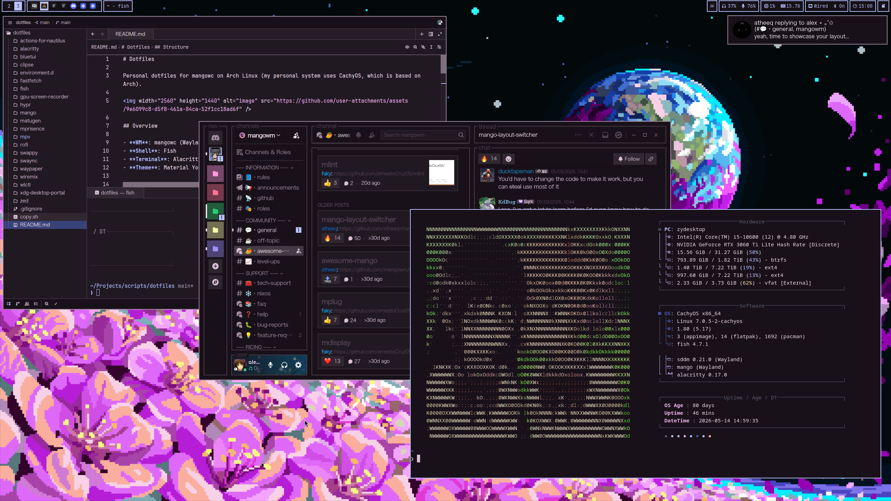

# Dotfiles

Personal dotfiles for mangowc on Arch Linux (my personal system uses CachyOS, which is based on Arch).



## Overview

- **WM**: mangowc (Wayland)
- **Shell**: Fish with [Starship](https://starship.rs)
- **Terminal**: Alacritty
- **Theme**: Material You theme generated via [Matugen](https://github.com/InioX/matugen)
- **Icons**: [Neuwaita](https://github.com/RusticBard/neuwaita)
- **Notifications**: [mako](https://github.com/emersion/mako)

## Structure

| Directory | Description |
|-----------|-------------|
| `actions-for-nautilus/` | [Configurable right click for nautilus](https://github.com/bassmanitram/actions-for-nautilus) |
| `alacritty/` | [Terminal](https://github.com/alacritty/alacritty) |
| `bluetui/` | [TUI bluetooth manager](https://github.com/pythops/bluetui) |
| `clipse/` | [Clipboard manager](https://github.com/savedra1/clipse) |
| `environment.d/` | Environment variables |
| `fastfetch/` | [System info](https://github.com/fastfetch-cli/fastfetch) |
| `fish/` | [Shell](https://github.com/fish-shell/fish-shell) |
| `gtk-3.0/`, `gtk-4.0/` | GTK settings and theme |
| `hypr/` | [Hyprlock & hypridle](https://github.com/hyprwm/hyprlock) |
| `mako/` | [Notification daemon](https://github.com/emersion/mako) config and colors |
| `mango/` | [Wayland compositor](https://github.com/mangowm/mango) |
| `matugen/` | [Color theming](https://github.com/InioX/matugen) |
| `qt5ct/`, `qt6ct/` | Qt theming |
| `rofi/` | [App launcher](https://github.com/davatorium/rofi) |
| `starship/` | Shell prompt |
| `swappy/` | [Screenshot markup](https://github.com/jtheoof/swappy) |
| `waypaper/` | [Wallpaper](https://github.com/anufrievroman/waypaper) |
| `wiremix/` | PipeWire audio mixer TUI |
| `wlctl/` | [TUI Wi-Fi manager](https://github.com/aashish-thapa/wlctl) |
| `xdg-desktop-portal/` | [Portal config](https://github.com/flatpak/xdg-desktop-portal) |
| `zed/` | [Code editor](https://github.com/zed-industries/zed) |
| `mimeapps.list` | Default mimetype associations, including Windows `.exe` via `winrun` |
| `xdg-terminals.list` | Default terminal for `xdg-terminal-exec` |
| `_setup/` | Installer assets: local scripts, desktop entries, fish overrides, SDDM themes, templates and extension configs |

Config not in this repo - `mpv/` is cloned from
[zydezu/mpvconfig](https://github.com/zydezu/mpvconfig) at install time, and
`gpu-screen-recorder` has no config to keep.

## Installation

### Automated install

On a fresh CachyOS/Arch install:

```bash
git clone https://github.com/zydezu/dotfiles.git
cd dotfiles
./install.sh
```

This installs the packages below, copies configs into `~/.config`, and downloads the
font and icon archives from the
[Assets release](https://github.com/zydezu/dotfiles/releases/tag/Assets)
(checksum-verified). It prompts for Steam/gamescope, Discord, Cloudflare Warp,
yt-dlp/gallery-dl and Tailscale, and offers a **low end mode** (off by default) that
disables mango blur/shadows/animations, GTK and hyprlock animations, hyprlock blur, and
slows waybar polling while dropping its VRAM and gamepad modules.

The installer reboots at the end. After logging in, `post-install.sh` runs
automatically once in a terminal to generate the theme, finish Tailscale/Warp setup,
disable copy-on-write for the Steam library on btrfs, and remove the cloned dotfiles
directory. A stamp file keeps it from running on later logins; run `~/post-install.sh`
manually if you need it again.

> **Warning:** `install.sh` replaces existing files in `~/.config` without backing them up.
> Review the script, and back up your configs first if this is not a fresh system.

### Packages (manual)

If you prefer to install packages yourself, or want to see what `install.sh` pulls in:

```bash
yay -S \
    `# compositor & bar` \
    mangowm waybar \
    `# portals & session` \
    xdg-desktop-portal xdg-desktop-portal-gtk xdg-desktop-portal-wlr \
    xdg-terminal-exec-git xfce-polkit dex \
    `# wallpaper, notifications & lock` \
    swaybg waypaper mako sway-audio-idle-inhibit-git hyprlock hypridle dunst \
    `# launcher & screenshot` \
    rofi rofi-power-menu grim slurp wayfreeze swappy gpu-screen-recorder \
    `# theming` \
    matugen adw-gtk-theme adwaita-fonts ttf-jetbrains-mono-nerd noto-fonts \
    qt5ct qt6ct qt6-declarative qt6-svg \
    qt5-quickcontrols qt5-quickcontrols2 qt5-declarative qt5-graphicaleffects \
    `# terminal, shell & editors` \
    alacritty fish zed starship fd eza bat \
    `# apps` \
    helium-browser-bin nautilus actions-for-nautilus-git warehouse \
    gnome-keyring gnome-font-viewer baobab file-roller unrar unzip fuse2 p7zip \
    mpv qimgv exiftool \
    `# image format support` \
    libheif libavif qt5-avif-image-plugin qt6-avif-image-plugin \
    qt5-jpegxl-image-plugin qt6-jpegxl-image-plugin qt-jpegxl qt-heif-image-plugin kimageformats \
    `# audio` \
    pipewire wireplumber wiremix \
    `# clipboard` \
    clipse wl-clipboard wl-clip-persist \
    `# system utilities` \
    networkmanager brightnessctl cachy-update fastfetch github-cli uv sddm \
    `# filesystems & network shares` \
    samba exfatprogs xfsprogs ntfsprogs btrfs-progs dosfstools e2fsprogs \
    f2fs-tools jfsutils squashfs-tools cifs-utils fuse3 nfs-utils sshfs davfs2 \
    gvfs-smb gvfs-dnssd gvfs-wsdd gvfs-nfs gvfs-mtp gvfs-gphoto2 gvfs-afc \
    `# tui tools` \
    bluetui wlctl
```

`install.sh` also installs `yay` if missing. Steam, proton-cachyos-slr, gamescope,
Discord, `aur/warp-cli`, yt-dlp/gallery-dl and Tailscale are only installed if you
answer yes to their prompts.

### Copy Configs

```bash
./copy.sh
```

Run this script to copy the specified configs from `~/.config` to the dotfiles repo.

### Apply Theme

Use waypaper to change the wallpaper and generate the corresponding matugen theme from it, applying to all configured applications.

## Keybinds

### Apps

Binds to launch various applications.

| Key | Action |
|-----|--------|
| <kbd>Super</kbd> + <kbd>Return</kbd> | Launch alacritty |
| Release <kbd>Super</kbd> | Toggle rofi (app launcher) |
| <kbd>Super</kbd> + <kbd>l</kbd> | Lock session |
| <kbd>Super</kbd> + <kbd>b</kbd> | Launch Helium browser |
| <kbd>Super</kbd> + <kbd>d</kbd> | Launch Discord (if installed) |
| <kbd>Super</kbd> + <kbd>e</kbd> | Launch Nautilus |
| <kbd>Super</kbd> + <kbd>z</kbd> | Launch Zed |
| <kbd>Super</kbd> + <kbd>v</kbd> | Launch clipse |
| <kbd>Super</kbd> + <kbd>s</kbd> | Launch wiremix (audio mixer) |
| <kbd>Super</kbd> + <kbd>w</kbd> | Toggle Cloudflare WARP (if installed) |
| <kbd>Ctrl</kbd> + <kbd>Shift</kbd> + <kbd>Esc</kbd> | Launch btop |
| <kbd>Super</kbd> + <kbd>Shift</kbd> + <kbd>c</kbd> | Launch color picker |
| <kbd>Super</kbd> + <kbd>Shift</kbd> + <kbd>n</kbd> | Toggle do-not-disturb |

### Screenshotting

Screenshots use grim and wl-copy, whilst screenrecording uses gpu-screen-recorder.

| Key | Action |
|-----|--------|
| <kbd>Print</kbd> | Screenshot (active screen) |
| <kbd>Alt</kbd> + <kbd>Print</kbd> | Screenshot (all screens) |
| <kbd>Ctrl</kbd> + <kbd>Print</kbd> | Screenshot (select region) |
| <kbd>Shift</kbd> + <kbd>Print</kbd> | Screen record (active screen) |
| <kbd>Ctrl</kbd> + <kbd>Shift</kbd> + <kbd>Print</kbd> | Screen record (select region) |

### Tags

Tags are numbered from 1 to 9, they act like separate workspaces.

| Key | Action |
|-----|--------|
| <kbd>Super</kbd> + <kbd>Left</kbd> | Switch tags to the left |
| <kbd>Super</kbd> + <kbd>Right</kbd> | Switch tags to the right |
| <kbd>Super</kbd> + <kbd>Ctrl</kbd> + <kbd>Left</kbd> | Move window to the left tag |
| <kbd>Super</kbd> + <kbd>Ctrl</kbd> + <kbd>Right</kbd> | Move window to the right tag |
| <kbd>Super</kbd> + <kbd>1-9</kbd> | Switch to numbered tag (follow the window) |
| <kbd>Super</kbd> + <kbd>Ctrl</kbd> + <kbd>1-9</kbd> | Send window to numbered tag (follow it) |
| <kbd>Super</kbd> + <kbd>Ctrl</kbd> + <kbd>Shift</kbd> + <kbd>1-9</kbd> | Send window to numbered tag (stay put) |

### Window Management

| Key | Action |
|-----|--------|
| <kbd>Super</kbd> + <kbd>q</kbd> | Kill focused client |
| <kbd>Super</kbd> + <kbd>Tab</kbd> | Toggle overview |
| <kbd>Alt</kbd> + <kbd>Tab</kbd> | Cycle windows within the overview |
| <kbd>Super</kbd> + <kbd>g</kbd> | Toggle global, then overlay |
| <kbd>Super</kbd> + <kbd>f</kbd> | Toggle floating |
| <kbd>Super</kbd> + <kbd>t</kbd> | Switch layout |
| <kbd>Super</kbd> + <kbd>m</kbd> | Minimize window |
| <kbd>Super</kbd> + <kbd>n</kbd> | Restore minimized |
| <kbd>Super</kbd> + <kbd>Alt</kbd> + <kbd>m</kbd> | Toggle scratchpad |

`Super+g` is bound twice — `toggleglobal` then `toggleoverlay` — so the first
press toggles global and the second toggles the overlay.

### Window Movement / Swap

| Key | Action |
|-----|--------|
| <kbd>Super</kbd> + <kbd>Shift</kbd> + <kbd>Left/Right</kbd> | Focus left/right client |
| <kbd>Super</kbd> + <kbd>Alt</kbd> + <kbd>←↑↓→</kbd> | Exchange client with neighbour |
| <kbd>Super</kbd> + <kbd>Ctrl</kbd> + <kbd>Shift</kbd> + <kbd>Left/Right</kbd> | Move current tag to left/right monitor |
| <kbd>Super</kbd> + <kbd>Ctrl</kbd> + <kbd>Alt</kbd> + <kbd>Left/Right</kbd> | Focus left/right monitor |
| <kbd>Super</kbd> + <kbd>Left click</kbd> | Move window |
| <kbd>Super</kbd> + <kbd>Right click</kbd> | Resize window |

### Misc

| Key | Action |
|-----|--------|
| <kbd>Super</kbd> + <kbd>Shift</kbd> + <kbd>r</kbd> | Reload config |
| <kbd>Super</kbd> + <kbd>Shift</kbd> + <kbd>w</kbd> | Reload waybar |

### Gaps

| Key | Action |
|-----|--------|
| <kbd>Alt</kbd> + <kbd>Shift</kbd> + <kbd>x</kbd> | Increase gaps |
| <kbd>Alt</kbd> + <kbd>Shift</kbd> + <kbd>z</kbd> | Decrease gaps |
| <kbd>Alt</kbd> + <kbd>Shift</kbd> + <kbd>r</kbd> | Toggle gaps |

### Volume / Media Keys

| Key | Action |
|-----|--------|
| <kbd>XF86AudioRaiseVolume</kbd> | Volume +5% |
| <kbd>XF86AudioLowerVolume</kbd> | Volume -5% |
| <kbd>XF86AudioMute</kbd> | Toggle mute |
| <kbd>XF86AudioPlay</kbd> | Play / pause |
| <kbd>XF86AudioNext</kbd> | Next track |
| <kbd>XF86AudioPrev</kbd> | Previous track |
| <kbd>XF86AudioStop</kbd> | Stop |
| <kbd>XF86MonBrightnessUp</kbd> | Brightness +5% |
| <kbd>XF86MonBrightnessDown</kbd> | Brightness -5% |

### Gestures (3-finger)

| Gesture | Action |
|---------|--------|
| Swipe right | View to left |
| Swipe left | View to right |
| Swipe up | Toggle overview |
| Swipe down | Toggle overview |

### Settings

| Setting | Value |
|---------|-------|
| Keyboard layout | gb (compose on Menu) |
| Mouse natural scroll | Off |
| Trackpad natural scroll | On |
| Disable while typing | Off |

See `mango/binds.toml` for the full list.

Before starting mangowm, make sure `mango/monitor.toml` matches your display setup so the desktop loads correctly.

## Things To Check

When applying these dotfiles and logging into mango from your login manager, it may seem like things are not working. Check `mango/monitor.toml`, `mango/waybar/config.jsonc` and `hypr/hyprlock.conf` for hardcoded monitor outputs like `DP-1`; remove or change them as needed. `install.sh` strips monitor-specific lines automatically.
